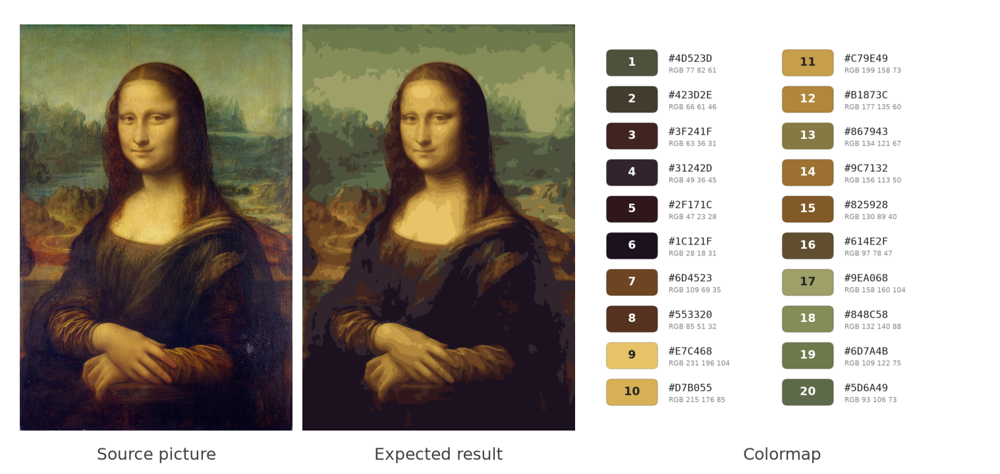
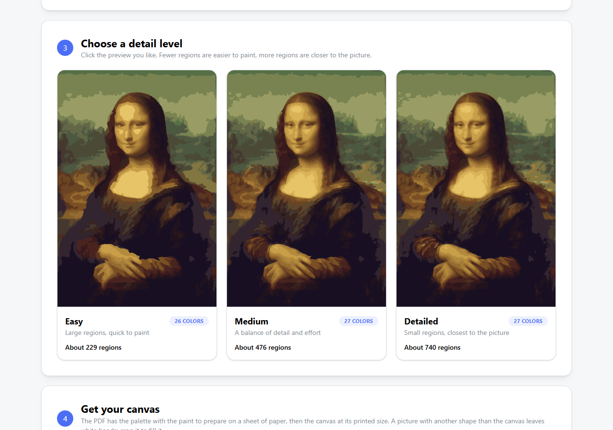
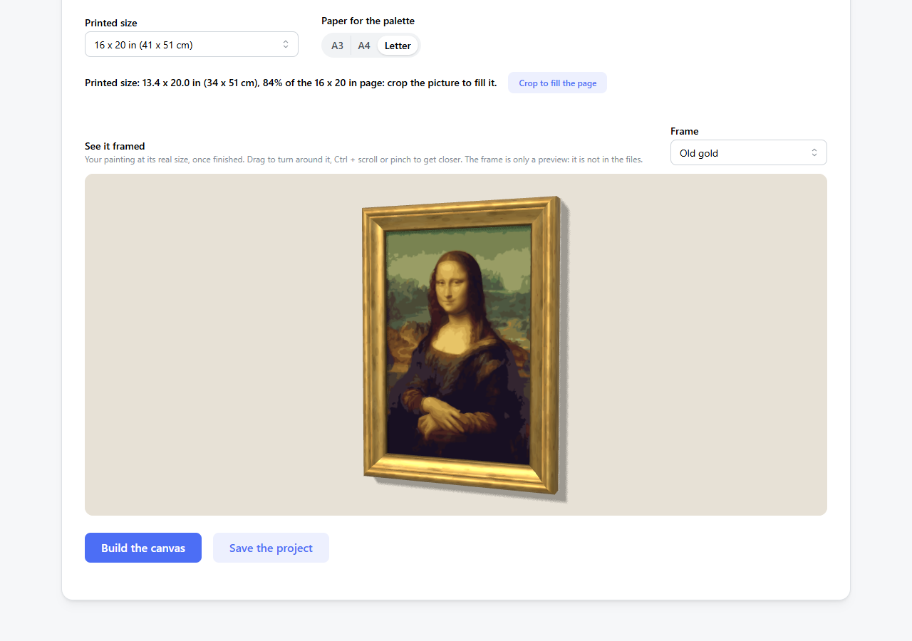
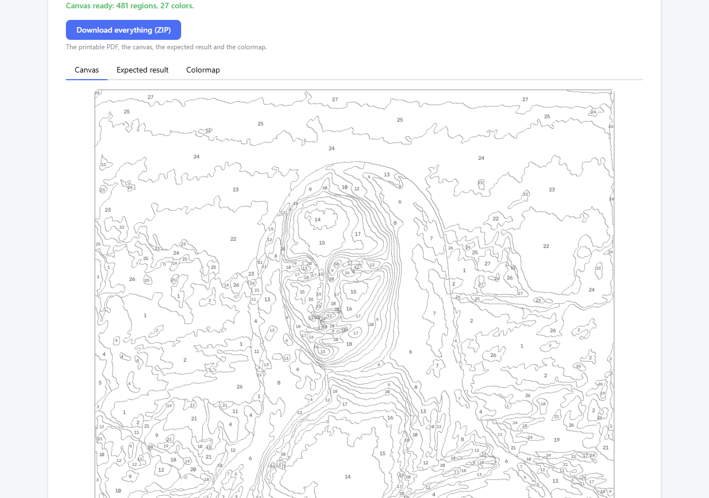
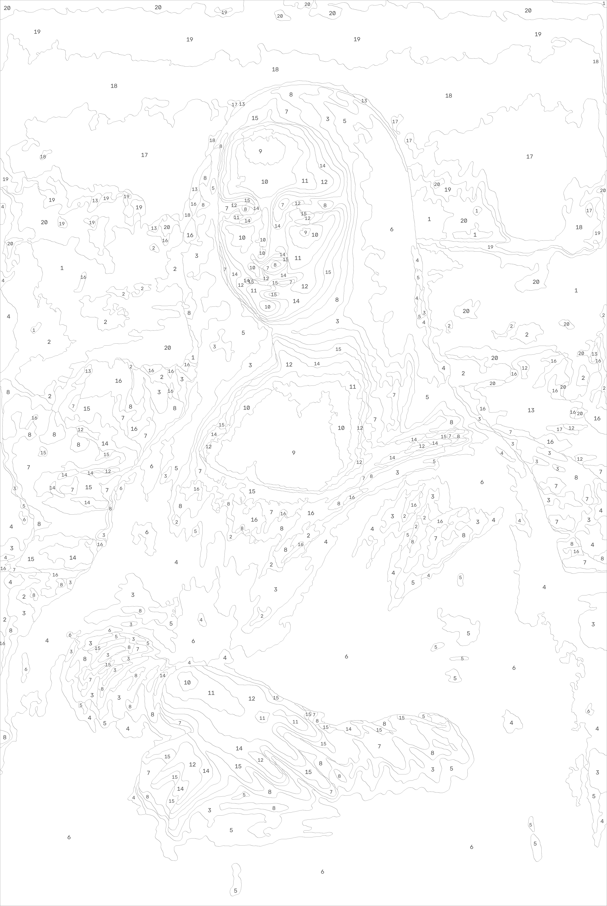
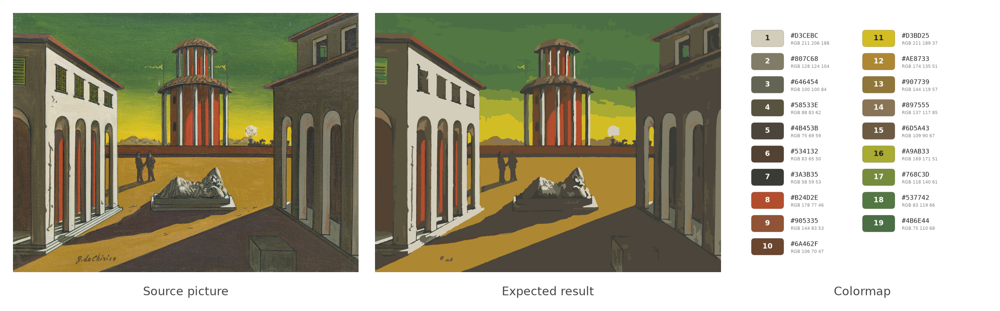
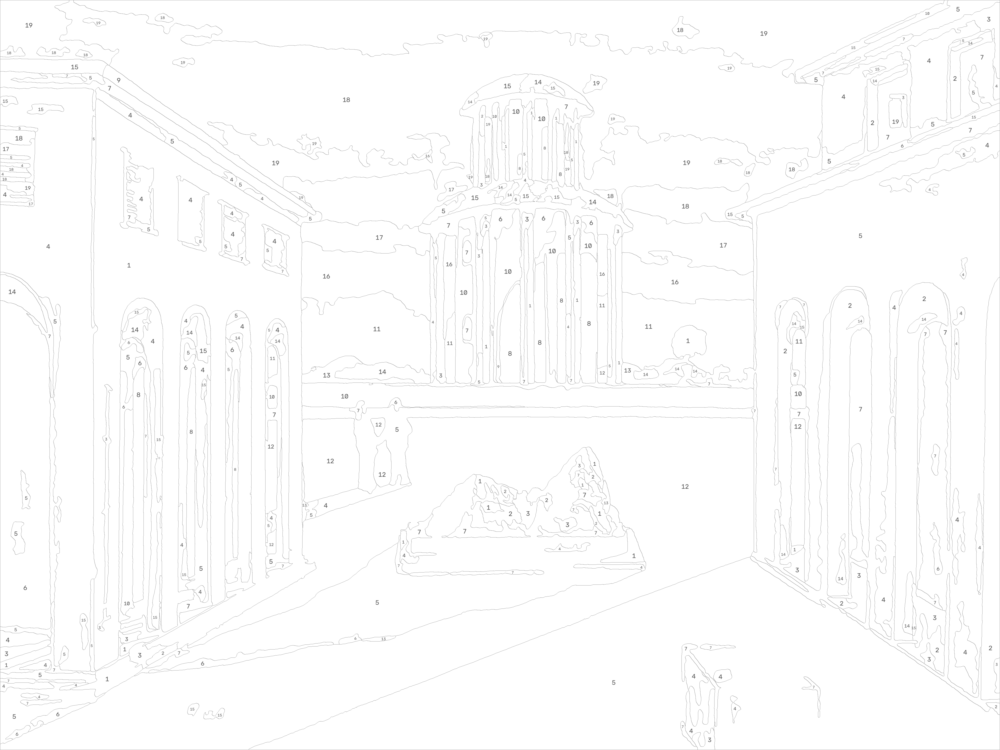

# paint-by-numbers

[](https://www.python.org/)
[](https://github.com/astral-sh/uv)
[](https://opencv.org/)
[](https://scikit-learn.org/)
[](LICENSE)

**Turn any picture into a paint-by-numbers canvas**, with its palette and a printable PDF at a real canvas size.



## Quick start

You need [uv](https://docs.astral.sh/uv/getting-started/installation/). It installs Python and the dependencies for you.

```bash
git clone https://github.com/Haha89/paint-by-numbers.git
cd paint-by-numbers
uv sync
uv run app.py
```

Then open http://127.0.0.1:8051 and drop a picture. Not sure which one? Try one of the pictures in [`inputs/`](inputs).

## The web interface

**1. Choose a picture**: upload one (PNG, JPEG or WebP) or paste a link to one, then crop it if you want.

**2. Set the colors**: each color is a paint to prepare. Colors too close to tell apart are merged, so the canvas may use a few less.

**3. Choose a detail level**: compare the three levels side by side and click the one you like.



**4. Get your canvas**: choose the printed size and the paper for the palette, crop the picture to fill the canvas in one click, and get warned when the numbers will be too crowded at this size. Drag the 3D preview to see your painting in a wood or gold frame.



Build the canvas, then download the PDF and the pictures in a ZIP. Save the project in the browser to come back to it later, with its picture, crop and settings.



Options: `uv run app.py [--host H] [--port N] [--debug]`.

## The command line

```bash
uv run run.py inputs/chirico.jpg 20 --title "Place d'Italie" --subtitle "Giorgio De Chirico, 1922"
```

The results are saved in `./outputs`, which git ignores.

<details>
<summary>All the options</summary>

`uv run run.py path nb_color [--plot] [--no-save] [--pixel-size N] [--detail D] [--output-dir DIR] [--no-pdf] [--title T] [--subtitle S] [--paper P] [--print-size S] [--crop-to-fill]`

| Option | Description |
|---|---|
| `path` | path of the source picture |
| `nb_color` | number of colors you want in the canvas (10 to 20) |
| `--plot` | show the results in plots |
| `--no-save` | do not save the results in the output folder |
| `--pixel-size` | size in pixels of the largest dimension of the output canvas (default 4000) |
| `--detail` | balance between easy to paint and faithful to the picture: `easy`, `medium` or `detailed` (default `medium`) |
| `--output-dir` | folder where results are saved (default `./outputs`) |
| `--no-pdf` | do not save the printable PDF |
| `--title` | title printed in the PDF (default: name of the picture) |
| `--subtitle` | subtitle printed in the PDF, e.g. the artist and year |
| `--paper` | PDF paper size: `a4`, `a3` or `letter` (default `a4`) |
| `--print-size` | standard canvas size in inches: `8x10`, `9x12`, `11x14`, `12x16`, `16x20`, `18x24` or `24x36`. The PDF canvas page gets exactly this size, without margins, and the palette stays on the paper size (default: the canvas fits the paper) |
| `--crop-to-fill` | crop the picture around its center to the shape of `--print-size`, to avoid white bands |

</details>

## Examples

#### Leonardo da Vinci, Mona Lisa (20 colors requested)


#### De Chirico, Place d'Italie, 1922 (20 colors requested, 19 kept after merging the closest ones)



#### Printable PDFs
Palette page, then vector canvas page:
- [Place d'Italie, De Chirico](docs/examples/chirico.pdf)
- [Mona Lisa, Leonardo da Vinci](docs/examples/joconde.pdf)
- [Paysage](docs/examples/paysage.pdf)

## How it works

1. The picture is resized and denoised with a bilateral filter, which flattens the textures but keeps the edges sharp.
2. K-means, in the CIELAB color space, finds the k colors that best summarize the picture. The faces found in the picture, or else its center, count more so that the subject gets more shades. Colors too close to tell apart are merged.
3. The picture is transformed to match these colors, with smoothed borders.
4. Regions too small or too thin to be painted are merged into their neighbour of closest color, with a lower limit inside the faces to keep the eyes and the mouth. Colors barely used are replaced by their closest color.
5. The borders and the label of each region are drawn on a new canvas, repeated in the large regions.
6. The colormap is sorted by hue and lightness, and a printable PDF is made: a palette page with the share of the canvas and the estimated paint of each color, then a vector canvas page.

## For developers

The `paint_by_numbers` package holds the `Canvas` class in `canvas.py`, each step in its own module (`preprocessing.py`, `colors.py`, `regions.py` and `export.py`), and the web interface in `web/`. It is built on NumPy, OpenCV, scikit-learn, Matplotlib, and Dash with Dash Mantine Components.

Run the tests with `uv run pytest`. They run in parallel on up to 8 processes; add `-n 0` for a single one, e.g. to debug. The browser tests use your installed Chrome, and are skipped without it.

See the [roadmap](ROADMAP.md) for the next steps.
