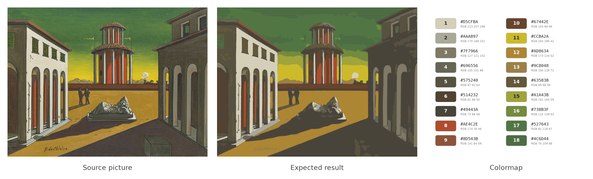
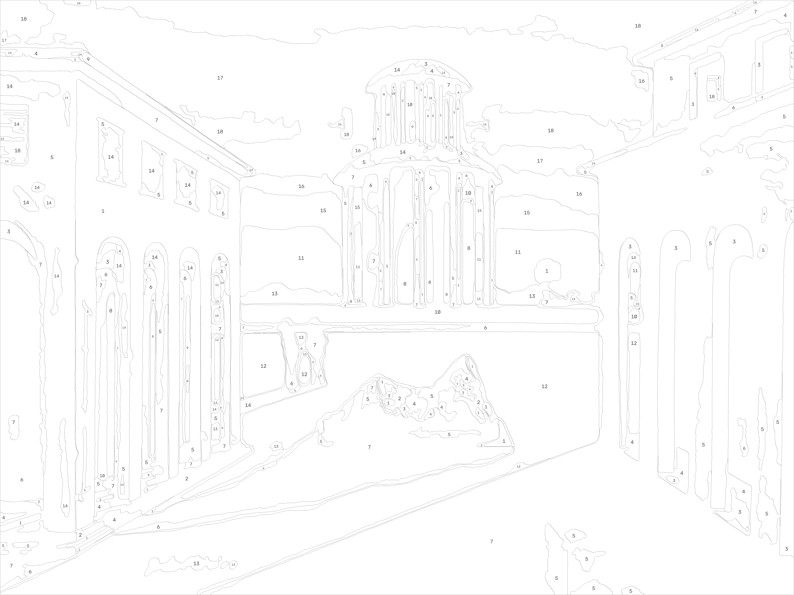
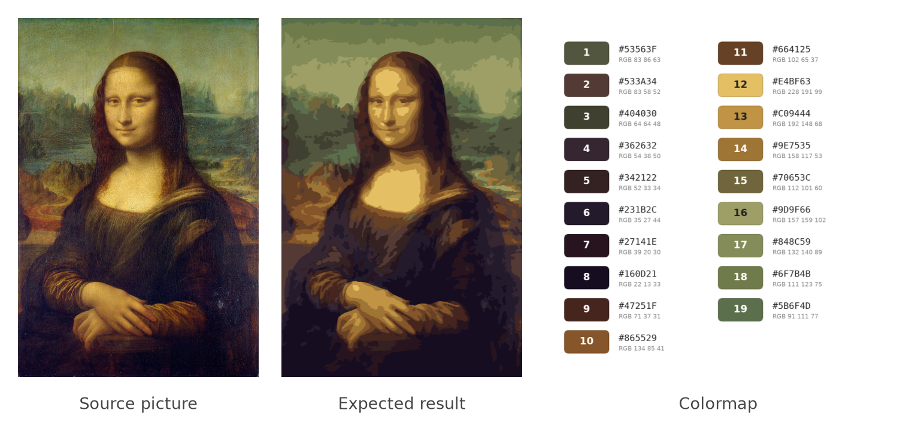

# paint-by-numbers

A quick Python tool to transform any picture in a paint-by-number canvas, using opencv

# How it works
1) Picture is resized and denoised with a bilateral filter, which flattens the textures but keeps the edges sharp  
2) K-mean algorithm, in the CIELAB color space, to detect the k-colors summarizing the best the picture, the faces found in the picture, or else its center, counting more so that the subject gets more shades, merging the colors too close to tell apart  
3) Transformation of the picture to match these colors, with smoothed borders  
4) Regions too small or too thin to be painted are merged into their neighbour of closest color, with a lower limit inside the faces to keep the eyes and the mouth, and colors barely used are replaced by their closest color  
5) Drawing of the borders and of the label of each region on a new canvas, repeated in the large regions  
6) Creation of the colormap for the user, sorted by hue and lightness, and of a printable PDF (palette page with the share of the canvas and the estimated paint of each color, then vector canvas page)

# This project includes
A set of PNG pictures in `./inputs` folder, associated canvas and colormaps in the `./outputs` folder
The `paint_by_numbers` package, with the class Canvas in `canvas.py` and each step in its own module: `preprocessing.py`, `colors.py`, `regions.py` and `export.py`, and the web interface in `web/`

### Requirements:
- Numpy
- Matplotlib
- OpenCV
- scikit-learn
- Dash and Dash Mantine Components, for the web interface

Dependencies are managed with [uv](https://docs.astral.sh/uv/). Install them with `uv sync`.

### Web interface:
run `uv run app.py [--host H] [--port N] [--debug]`, then open http://127.0.0.1:8051

Upload a picture or paste a link to one, crop it if you want, compare the detail levels side by side, choose the printed size, crop the picture to fill it in one click, get warned when the numbers will be too crowded at this size, see your painting in 3D in a wood or gold frame, then download the PDF and the pictures in a ZIP. Save the project in the browser to come back to it later, with its picture, crop and settings.

### Execution:
run `uv run run.py path nb_color [--plot] [--no-save] [--pixel-size N] [--detail D] [--output-dir DIR] [--no-pdf] [--title T] [--subtitle S] [--paper P] [--print-size S] [--crop-to-fill]` with:

  **path**: path of the source picture  
  **nb_color** : number of colors you want in the canvas (10 to 20)  
  **--plot**: optional, show the results in plots  
  **--no-save**: optional, do not save the results in the output folder  
  **--pixel-size**: optional, integer, size in pixel of the largest dimension of the output canvas (default 4000)  
  **--detail**: optional, balance between easy to paint and faithful to the picture: `easy`, `medium` or `detailed` (default `medium`)  
  **--output-dir**: optional, folder where results are saved (default `./outputs`)  
  **--no-pdf**: optional, do not save the printable PDF  
  **--title**: optional, title printed in the PDF (default: name of the picture)  
  **--subtitle**: optional, subtitle printed in the PDF, e.g. the artist and year  
  **--paper**: optional, PDF paper size: `a4`, `a3` or `letter` (default `a4`)  
  **--print-size**: optional, standard canvas size in inches: `8x10`, `9x12`, `11x14`, `12x16`, `16x20`, `18x24` or `24x36`. The PDF canvas page gets exactly this size, without margins, and the palette stays on the paper size (default: the canvas fits the paper)  
  **--crop-to-fill**: optional, crop the picture around its center to the shape of `--print-size`, to avoid white bands

Example: `uv run run.py inputs/chirico.jpg 20 --title "Place d'Italie" --subtitle "Giorgio De Chirico, 1922"`

### Tests:
run `uv run pytest`. The tests run in parallel on up to 8 processes, add `-n 0` for a single one, e.g. to debug. The browser tests use your installed Chrome, and are skipped without it.

### Result:

#### De Chirico, Place d'Italie, 1922 (20 colors requested, 19 kept after merging the closest ones)

#### Leonardo da Vinci, Mona Lisa (20 colors requested, 19 kept)

#### Printable PDFs
Palette page, then vector canvas page:
- [Place d'Italie, De Chirico](outputs/chirico.pdf)
- [Mona Lisa, Leonardo da Vinci](outputs/joconde.pdf)
- [Paysage](outputs/paysage.pdf)

### Next Steps:
See the [roadmap](ROADMAP.md).
